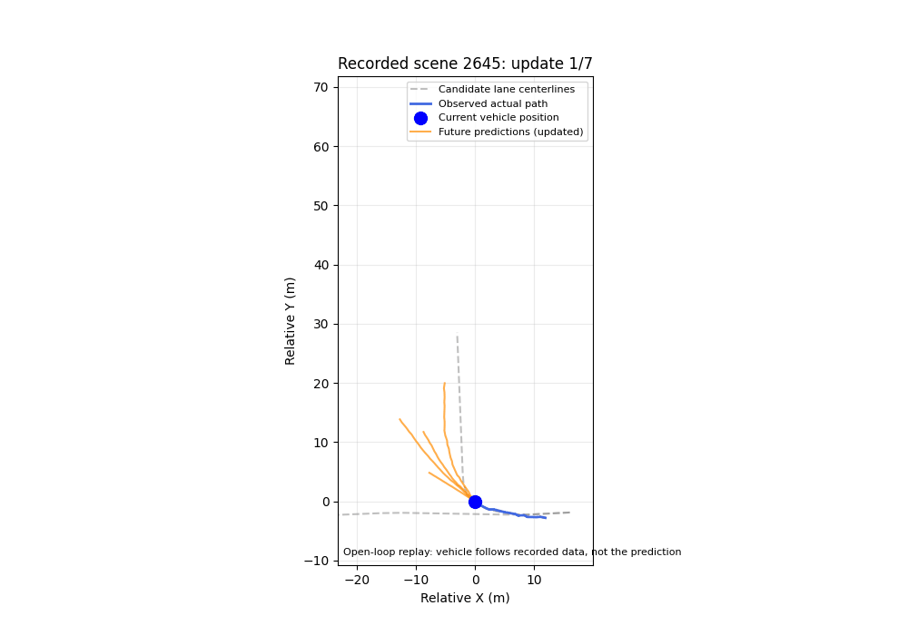
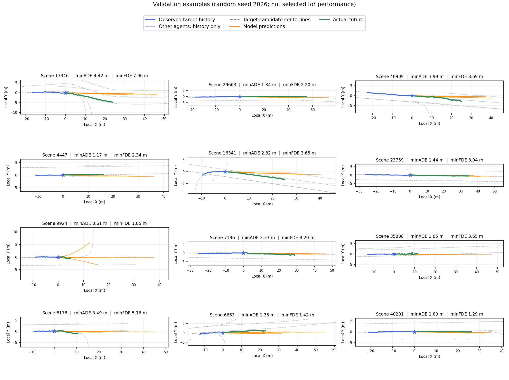

# Map-Adaptive Multimodal Trajectory Prediction

**An unofficial PyTorch implementation inspired by hierarchical graph neural networks for vehicle trajectory prediction.** Given recorded vehicle motion and a high-definition map, the model predicts a variable number of possible future trajectories for a target vehicle.

This project is a learning and research implementation, **not an exact reproduction of the paper**. The real-data training and validation pipeline runs end to end; the architecture, loss and evaluation protocol retain important differences described below.

> Reference: Xiaoyu Mo, Yang Xing, Haochen Liu, and Chen Lv, “Map-Adaptive Multimodal Trajectory Prediction Using Hierarchical Graph Neural Networks,” *IEEE Robotics and Automation Letters*, 2023. [Paper](https://doi.org/10.1109/LRA.2023.3270739)

## Objective

Predict where a target vehicle may move over the next three seconds using:

- its observed motion and the motion of nearby agents;
- candidate lane centerlines (CCLs) from an HD map;
- a graph that captures target-agent, surrounding-agent and lane relationships.

The predictor outputs multiple possible trajectories, rather than a single path. It does **not** output calibrated trajectory probabilities, detect vehicles in camera images, or control a vehicle.

## Demo: updating predictions during a recorded scene



- **Blue point and line:** the target vehicle and its observed path so far.
- **Orange lines:** trajectories predicted from the history available at each update.
- **Gray dashed lines:** candidate lane centerlines associated with the target.

The vehicle follows recorded motion; the model does not control it. Predictions are updated every five recorded frames (about 0.5 seconds at 10 Hz). This short replay is an additional visualization, **not an experiment reported in the paper**, and its sample is not asserted to be held out. Toward the end of the recording, some predicted future extends beyond the available ground truth.

## Method overview

```text
Recorded agent histories + HD map
                 |
                 v
        Candidate centerline search
                 |
                 v
 Agent-history GRU    CCL GRU
          \             /
           v           v
         Heterogeneous scene graph
                 |
       Stage 1: surrounding CCL -> surrounding agent
       Stage 2: surrounding agents -> target agent
       Stage 3: target CCL -> target agent
                 |
                 v
       Graph-based prediction head
                 |
                 v
 m CCL-guided trajectories + 1 scene-reasoning trajectory
                           + 1 motion-maintaining trajectory
```

For each scene, `m` is the number of target CCLs. The resulting `m + 2` trajectories contain future XY positions. A virtual target node supports the motion-maintaining branch. The graph structure, training objective and implementation choices are approximations of the paper, rather than a verified line-by-line reproduction.

## Experiment and results

The model was trained on successfully processed **Argoverse 1 Motion Forecasting** data and evaluated on the separate official validation split.

| Setting | Result |
| --- | --- |
| Training scenes | 205,863 |
| Validation scenes | 39,468 |
| Training | 1 epoch; Adam; learning rate 0.001; seed 42 |
| Validation minADE | 1.728 m |
| Validation minFDE | 3.369 m |
| Skipped during preparation | 79 training and 4 validation scenes |

**How to read the metrics:** for each scene, minADE is the smallest average position error across the predicted trajectories; minFDE is the smallest endpoint error. The minima can come from different trajectories. Lower is better, but a best-of-set metric does not identify which trajectory is most likely before the future is known.

**Comparison caveat:** these numbers are from the validation split and a variable number of output modes. The paper's Argoverse benchmark table uses its test split and a fixed-six-output decoder. Our run also used one epoch and differs in architecture and loss, so the results are **not directly comparable to that table**.

### Example predictions



The 12 scenes were randomly selected using seed 2026; they were not selected for model performance. **Blue** shows observed target history, **light blue** shows other agents' history, **gray dashed** shows target CCLs, **orange** shows predictions, and **green** shows the recorded future. Each scene is displayed in its own local coordinates. See [the experiment report](docs/TRAINING_RESULTS.md) for details. The figures illustrate individual cases; they do not replace the validation-set metrics above.

## Repository guide

```text
src/
  data/              Scene loading, map features, and graph preparation
  models/            GRU encoders, graph operators, decoder, and loss
  utils/             Trajectory evaluation metrics
scripts/
  prepare_dataset.py               Prepare cached scenes from Argoverse archives
  train_cached.py                  Train, save, and evaluate the model
  replay_prediction.py             Generate a recorded-scene replay
  visualize_centerlines.py         Plot CCLs for an example scene
  visualize_validation_examples.py Plot randomly selected validation cases
tests/               Component and scene-pipeline tests
docs/                Experiment report, setup notes, and visualizations
```

Raw data, processed caches, model checkpoints, local environments, third-party source and generated outputs are excluded from Git. The figures displayed above are deliberately included in `docs/figures/`.

## Setup and data

The reported run used Python 3.10, PyTorch 2.7.1, CUDA 12.8, PyTorch Geometric 2.6.1 and an NVIDIA GeForce RTX 5060 Laptop GPU. NumPy, pandas, matplotlib and the Argoverse map API dependencies are also needed. These are the **tested local versions**, not a guarantee that other environments will work.

1. Obtain the [Argoverse 1 Motion Forecasting dataset and HD maps](https://www.argoverse.org/av1.html), and review its data-use terms.
2. Prepare the official [Argoverse API](https://github.com/argoverse/argoverse-api) and map files. The upstream installer does not officially support Windows; the current local workflow uses its source directly and may require additional dependencies. See [centerline setup notes](docs/argoverse_centerlines.md).
3. Place the data where the scripts expect it, or use their command-line path arguments. Processed data and checkpoints must be generated locally; they are not included in this repository.

A clean-environment installation has not yet been verified. Inspect each script's `--help` and the setup notes before running; avoid starting a full dataset job until the storage, network and compute requirements are understood.

## Run the workflow

The commands below are for the project's **already configured Windows environment**; change the Python path for your own environment. Full-data preparation and training can take substantial time.

**Run focused checks:**

```powershell
.\outputs\python310\python.exe -m unittest tests.test_scene_pipeline tests.test_visualize_centerlines -v
```

**Prepare the official training and validation splits:**

```powershell
.\outputs\python310\python.exe scripts\prepare_dataset.py --split train
.\outputs\python310\python.exe scripts\prepare_dataset.py --split val
```

The script streams the official archives unless a local archive is supplied. It writes processed scenes and skipped-scene records to a local SQLite cache. The map files and API dependencies must already be available.

**Train one epoch and evaluate the validation split:**

```powershell
.\outputs\python310\python.exe scripts\train_cached.py --epochs 1 --device cuda --output outputs\official_experiment
```

Use `--device cpu` if CUDA is unavailable. The script saves a checkpoint, per-scene metrics and a prediction image in the chosen output directory. A full run requires the prepared training and validation data. Evaluation occurs after training; it does not update model parameters.

**Generate the replay and example figures:**

```powershell
.\outputs\python310\python.exe scripts\replay_prediction.py
.\outputs\python310\python.exe scripts\visualize_validation_examples.py
```

Their default paths refer to the original local sample, cached validation data and `outputs/official_full/checkpoint.pt`. Use `--help` to inspect options. The visualization scripts require the checkpoint and data to exist locally.

## Known limitations and next steps

- This is a partial, unofficial implementation, not a confirmed reproduction of the paper's benchmark results.
- The reported model was trained for one epoch; a lower training loss alone does not establish generalization or safety.
- The current objective selects a prediction by minimum ADE and applies Smooth L1 loss. It has not been verified as the exact MTP matching and regression rule cited by the paper.
- GRU embedding, graph attention configuration and other implementation details differ from or have not been fully checked against the paper. A virtual-node self-loop transformation may not preserve motion features exactly as intended by the paper.
- Candidate centerlines depend on the available map and the search procedure; scenes that failed preprocessing are excluded and recorded.
- The replay is open-loop: it replays recorded vehicle motion and visualizes predictions, but has no planner, controller, ROS pipeline or closed-loop safety evaluation.
- Future work includes checking the loss and architecture against original references, evaluating additional training settings and improving the clean-environment setup.

## Acknowledgments

This project builds on the authors' paper, the [Argoverse dataset and API](https://www.argoverse.org/av1.html), [PyTorch](https://pytorch.org/) and [PyTorch Geometric](https://pytorch-geometric.readthedocs.io/). Please follow the respective dataset and software licenses when using them.
