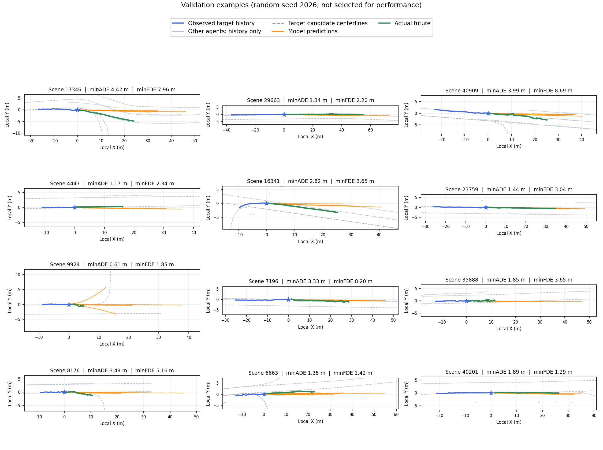
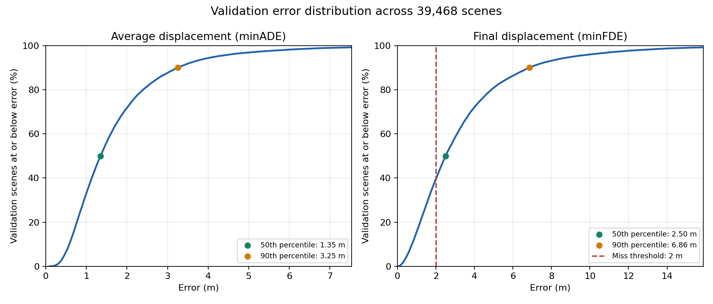

# Argoverse 1 trajectory prediction: training results

This project is an unofficial, partial implementation inspired by **Map-Adaptive Multimodal Trajectory Prediction Using Hierarchical Graph Neural Networks** (IEEE RA-L, 2023). It demonstrates an end-to-end training and evaluation pipeline; it is not a claim of exact paper reproduction.

## Experiment

- Dataset: Argoverse 1 Motion Forecasting, official training and validation splits; HD map information supplies candidate centerlines.
- Successfully processed scenes: 205,863 training and 39,468 validation; 79 training and 4 validation scenes were skipped by preprocessing checks.
- Training: one epoch, Adam, learning rate 0.001, seed 42; vehicle history and lane features feed a GRU/graph-attention predictor.
- Validation: mean minADE **1.728 m**, mean minFDE **3.369 m**, over the processed validation scenes and all modes returned by the map-adaptive predictor. Lower is better. These best-of-set metrics do not estimate mode probabilities.
- Settings differ from the paper, including the number of epochs, implementation details, loss, output-mode protocol and validation versus test split. These metrics should not be directly compared with the paper's fixed-six-mode test-set table.

## Examples



The plots show 12 validation examples sampled using random seed 2026, not chosen by model performance. Blue is observed target history, pale blue shows other agents' observed history, dashed gray is target candidate lane centerlines, orange is model predictions, and green is the recorded future. A few per-scene plot labels vary slightly from the original aggregate evaluation because predictions were recalculated in a different execution environment; the aggregate values above come from the original validation run. Twelve examples illustrate outcomes but do not replace evaluation over the full validation split.

## Reproducibility and limitations

Data archives, processed cache, the trained checkpoint, third-party source and generated outputs are not included in this repository. Training and evaluation require separately obtained Argoverse 1 data, its map/API, compatible dependencies, and the appropriate data-use terms. Candidate centerlines are derived only from observed histories. The current Windows API setup imports its source directly because the upstream installer does not officially support Windows. The model's ADE-selected Smooth L1 objective is an approximation and is not confirmed to be an exact implementation of the cited MTP loss.

This is a trajectory prediction experiment, not a closed-loop vehicle controller. A separate optional replay visualization shows changing predictions while replaying recorded motion; it is not an experiment reported in the paper and the replay's sample is not assumed to be held out.

## Validation error distribution

The aggregate analysis below uses the 39,468 successfully processed validation scenes recorded in `outputs/official_full/metrics.json`, without rerunning inference. It reports minimum errors across the trajectory modes returned for each scene.

| Metric | Mean | Median | 90th percentile | 95th percentile |
| --- | ---: | ---: | ---: | ---: |
| minADE (m) | 1.73 | 1.35 | 3.25 | 4.20 |
| minFDE (m) | 3.37 | 2.50 | 6.86 | 9.14 |

With an endpoint threshold of 2 m, **60.35%** of these scenes have a minFDE greater than 2 m: none of that scene's predicted endpoints is within 2 m of the recorded endpoint. This is an endpoint miss rate, not a collision rate or a probability of unsafe driving. The number of predicted trajectories varies by scene (3–20 in this result), and these validation-split numbers are **not directly comparable** to the paper's fixed-six-mode test-set benchmark.



Each curve shows the percentage of scenes whose minimum error is at or below the value on the horizontal axis. The plotted horizontal range ends near the 99th percentile; extreme errors beyond it are not shown. The 90th percentile means 90% of included scenes have an error at or below that value, not that 90% of predictions are safe.

To recompute from the saved local metrics file:

```powershell
.\outputs\python310\python.exe scripts\analyze_validation_errors.py
```

This produces a JSON summary and figure under `outputs/official_full/error_analysis/`. The raw per-scene metrics are local and excluded from Git.
